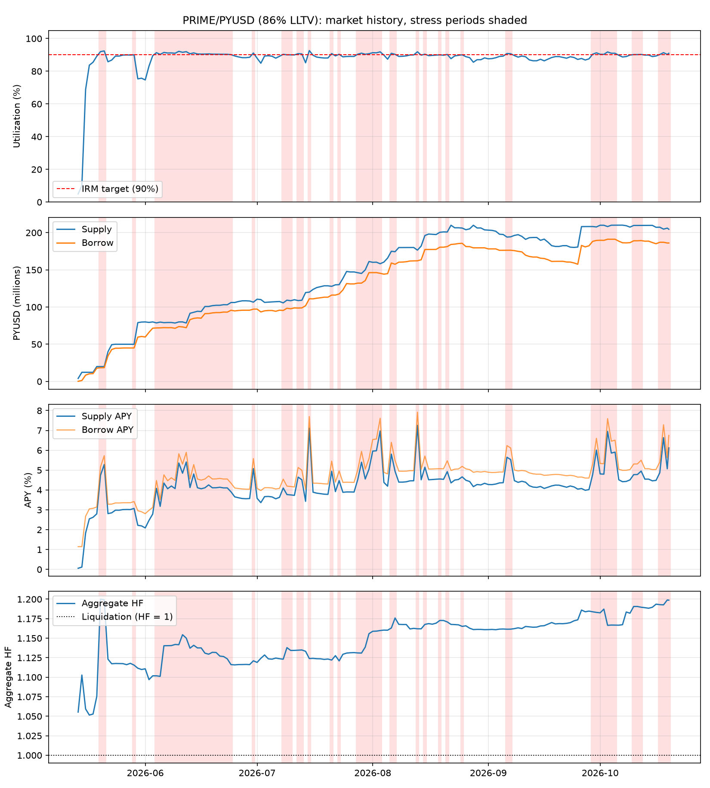

# Morpho Blue market report: PRIME/PYUSD (86% LLTV)
Market `0x41c41d0c9aadbf4751f5ee215ed5a16954a4b34e1b70fca5393d4b08858fa3fa` | chain 1 | data 2026-05-14 to 2026-10-19 (160 days) | generated 2026-10-19

## Summary
| Metric | Value |
|---|---|
| Latest supply / borrow (PYUSD) | 204,588,715 / 186,123,774 |
| Latest utilization | 91.0% |
| Days >= 90% utilization | 63 of 160 (39.4%) |
| Stress episodes / median duration | 20 / 2 d |
| Mean utilization in stress | 90.8% |
| Lowest free liquidity in stress | 1,516,274 PYUSD |
| Mean supply APY, stress vs normal | 4.89% vs 3.81% |
| Aggregate HF, min / stress median | 1.05 / 1.14 |
| Implied rate_at_target (stress mean) | 4.24% |

## Stress episodes (utilization >= 90%, amounts in PYUSD)
| Start | End | Days | Mean util | Max util | Min free liq | Peak supply | Peak borrow | Min agg HF |
|---|---|---|---|---|---|---|---|---|
| 2026-05-20 | 2026-05-21 | 2 | 92.2% | 92.4% | 1,516,274 | 20,004,286 | 18,488,012 | 1.20 |
| 2026-05-29 | 2026-05-29 | 1 | 90.0% | 90.0% | 4,972,274 | 49,971,212 | 44,998,939 | 1.12 |
| 2026-06-04 | 2026-06-24 | 21 | 90.9% | 92.2% | 6,257,590 | 106,086,880 | 95,667,086 | 1.10 |
| 2026-06-30 | 2026-06-30 | 1 | 91.2% | 91.2% | 9,411,686 | 106,597,182 | 97,185,496 | 1.12 |
| 2026-07-08 | 2026-07-10 | 3 | 90.1% | 90.3% | 10,198,424 | 109,255,779 | 98,389,065 | 1.12 |
| 2026-07-12 | 2026-07-13 | 2 | 90.7% | 90.7% | 10,065,492 | 109,128,004 | 98,857,940 | 1.13 |
| 2026-07-15 | 2026-07-15 | 1 | 92.6% | 92.6% | 8,836,233 | 119,993,127 | 111,156,894 | 1.12 |
| 2026-07-21 | 2026-07-21 | 1 | 90.8% | 90.8% | 11,744,266 | 127,846,935 | 116,102,670 | 1.12 |
| 2026-07-23 | 2026-07-23 | 1 | 90.4% | 90.4% | 12,501,990 | 130,107,880 | 117,605,890 | 1.12 |
| 2026-07-28 | 2026-08-03 | 7 | 91.0% | 91.9% | 12,870,666 | 161,207,230 | 146,299,070 | 1.13 |
| 2026-08-06 | 2026-08-07 | 2 | 90.7% | 91.0% | 15,788,917 | 174,993,368 | 159,204,451 | 1.16 |
| 2026-08-13 | 2026-08-13 | 1 | 91.9% | 91.9% | 14,304,710 | 176,502,569 | 162,197,859 | 1.16 |
| 2026-08-15 | 2026-08-15 | 1 | 90.4% | 90.4% | 18,799,506 | 196,184,520 | 177,385,014 | 1.17 |
| 2026-08-19 | 2026-08-19 | 1 | 90.0% | 90.0% | 20,046,560 | 200,500,031 | 180,453,471 | 1.17 |
| 2026-08-21 | 2026-08-21 | 1 | 90.3% | 90.3% | 19,581,457 | 200,895,221 | 181,313,764 | 1.17 |
| 2026-08-25 | 2026-08-25 | 1 | 90.0% | 90.0% | 20,522,008 | 206,207,356 | 185,685,348 | 1.17 |
| 2026-09-06 | 2026-09-07 | 2 | 90.8% | 90.8% | 17,777,810 | 194,407,957 | 176,361,786 | 1.16 |
| 2026-09-29 | 2026-10-05 | 7 | 90.9% | 91.8% | 17,068,617 | 210,044,650 | 191,154,430 | 1.17 |
| 2026-10-10 | 2026-10-12 | 3 | 90.2% | 90.3% | 20,381,801 | 209,736,103 | 189,354,301 | 1.19 |
| 2026-10-17 | 2026-10-19 | 4 | 90.7% | 91.4% | 17,682,337 | 207,344,989 | 187,079,181 | 1.19 |

## Stress vs normal
| Metric | Normal mean | Normal median | Normal p90 | Stress mean | Stress median | Stress p90 |
|---|---|---|---|---|---|---|
| Utilization | 86.14% | 88.76% | 89.87% | 90.83% | 90.60% | 91.85% |
| Supply APY | 3.81% | 4.14% | 4.50% | 4.89% | 4.78% | 6.00% |
| Borrow APY | 4.36% | 4.74% | 5.04% | 5.40% | 5.30% | 6.60% |
| rate_at_target (APR) | 4.38% | 4.69% | 4.95% | 4.24% | 4.27% | 4.94% |
| Aggregate HF | 1.14 | 1.16 | 1.17 | 1.15 | 1.14 | 1.19 |

## Theoretical supply APY by utilization (AdaptiveCurveIRM shape, fixed rate_at_target)
| rate_at_target | U=90% | U=93% | U=96% | U=100% |
|---|---|---|---|---|
| 2% | 1.8% | 3.5% | 5.4% | 8.0% |
| 4% | 3.6% | 7.1% | 10.8% | 16.0% |
| 8% | 7.2% | 14.1% | 21.5% | 32.0% |

## Expected supply APY on stress days
| rate_at_target | E[supply APY] |
|---|---|
| 2% | 2.27% |
| 4% | 4.54% |
| 8% | 9.07% |
| realized | 4.89% |

## Notes
- Theoretical rows hold rate_at_target fixed; the real curve adapts over time, so use the realized row.
- Aggregate HF = collateral USD x LLTV / borrow USD. It averages across borrowers and hides weak positions.
- Daily samples; intraday spikes in utilization are not captured.
