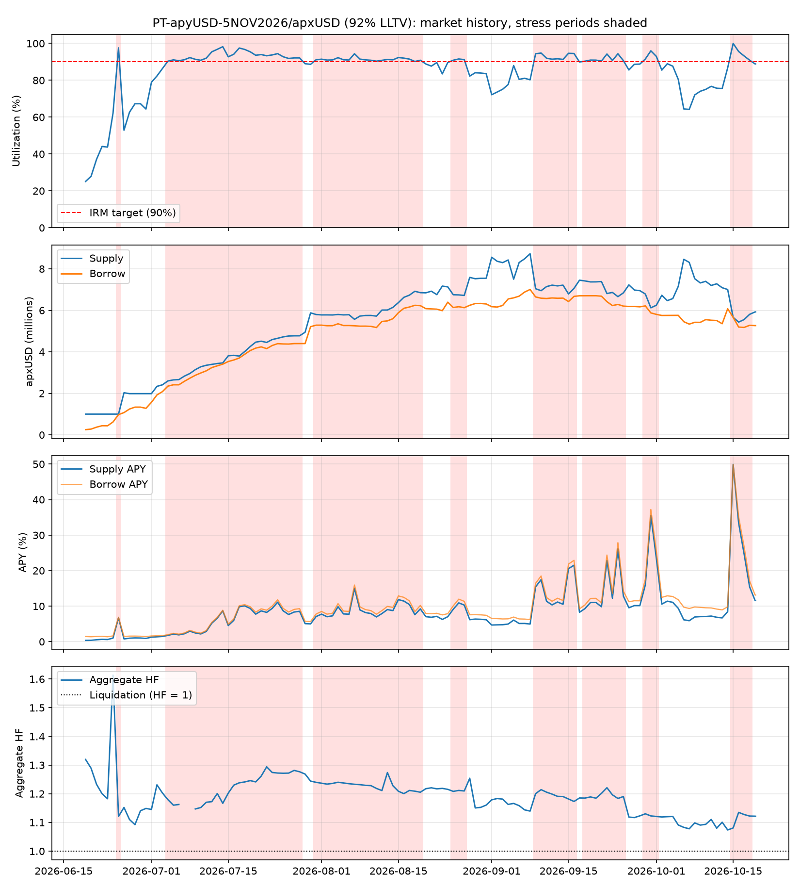

# Morpho Blue market report: PT-apyUSD-5NOV2026/apxUSD (92% LLTV)
Market `0xebd23a871b52e0a8c92bd719f4413600101b69e946cb72923b3a33fb5bc6ec85` | chain 1 | data 2026-06-19 to 2026-10-19 (124 days) | generated 2026-10-19

## Summary
| Metric | Value |
|---|---|
| Latest supply / borrow (apxUSD) | 5,924,944 / 5,265,546 |
| Latest utilization | 88.9% |
| Days >= 90% utilization | 72 of 124 (58.1%) |
| Stress episodes / median duration | 8 / 6 d |
| Mean utilization in stress | 92.7% |
| Lowest free liquidity in stress | 1 apxUSD |
| Mean supply APY, stress vs normal | 11.17% vs 5.55% |
| Aggregate HF, min / stress median | 1.07 / 1.21 |
| Implied rate_at_target (stress mean) | 6.32% |

## Stress episodes (utilization >= 90%, amounts in apxUSD)
| Start | End | Days | Mean util | Max util | Min free liq | Peak supply | Peak borrow | Min agg HF |
|---|---|---|---|---|---|---|---|---|
| 2026-06-25 | 2026-06-25 | 1 | 97.6% | 97.6% | 24,082 | 1,000,115 | 976,033 | 1.12 |
| 2026-07-04 | 2026-07-28 | 25 | 93.4% | 98.2% | 61,230 | 4,774,226 | 4,399,226 | 1.15 |
| 2026-07-31 | 2026-08-19 | 20 | 91.4% | 94.4% | 311,070 | 6,918,679 | 6,242,429 | 1.20 |
| 2026-08-25 | 2026-08-27 | 3 | 91.2% | 91.6% | 568,102 | 6,751,965 | 6,175,343 | 1.21 |
| 2026-09-09 | 2026-09-16 | 8 | 93.1% | 94.8% | 362,698 | 7,214,316 | 6,673,631 | 1.17 |
| 2026-09-18 | 2026-09-25 | 8 | 91.6% | 94.4% | 373,642 | 7,416,882 | 6,704,431 | 1.18 |
| 2026-09-29 | 2026-10-01 | 3 | 93.5% | 96.0% | 245,226 | 6,786,271 | 6,213,672 | 1.12 |
| 2026-10-15 | 2026-10-18 | 4 | 94.9% | 100.0% | 1 | 5,807,366 | 5,662,110 | 1.08 |

## Stress vs normal
| Metric | Normal mean | Normal median | Normal p90 | Stress mean | Stress median | Stress p90 |
|---|---|---|---|---|---|---|
| Utilization | 75.38% | 80.48% | 88.87% | 92.66% | 91.77% | 95.59% |
| Supply APY | 5.55% | 6.17% | 10.16% | 11.17% | 9.18% | 21.43% |
| Borrow APY | 6.90% | 7.54% | 11.77% | 12.01% | 9.97% | 22.80% |
| rate_at_target (APR) | 7.23% | 7.62% | 12.07% | 6.32% | 6.57% | 10.67% |
| Aggregate HF | 1.17 | 1.15 | 1.24 | 1.21 | 1.21 | 1.27 |

## Theoretical supply APY by utilization (AdaptiveCurveIRM shape, fixed rate_at_target)
| rate_at_target | U=90% | U=93% | U=96% | U=100% |
|---|---|---|---|---|
| 2% | 1.8% | 3.5% | 5.4% | 8.0% |
| 4% | 3.6% | 7.1% | 10.8% | 16.0% |
| 8% | 7.2% | 14.1% | 21.5% | 32.0% |

## Expected supply APY on stress days
| rate_at_target | E[supply APY] |
|---|---|
| 2% | 3.36% |
| 4% | 6.72% |
| 8% | 13.44% |
| realized | 11.17% |

## Notes
- Theoretical rows hold rate_at_target fixed; the real curve adapts over time, so use the realized row.
- Aggregate HF = collateral USD x LLTV / borrow USD. It averages across borrowers and hides weak positions.
- Daily samples; intraday spikes in utilization are not captured.
