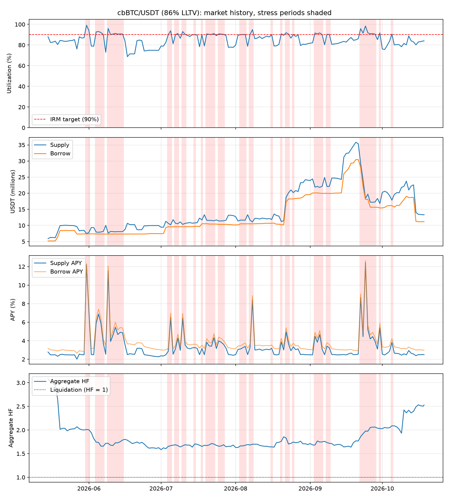

# Morpho Blue market report: cbBTC/USDT (86% LLTV)
Market `0x4fe72543c5c95cd6b5f3cb516cd235ba882e2e705fe3424db6f99dfe5811d0d3` | chain 1 | data 2026-05-15 to 2026-10-18 (158 days) | generated 2026-10-18

## Summary
| Metric | Value |
|---|---|
| Latest supply / borrow (USDT) | 13,322,553 / 11,178,305 |
| Latest utilization | 83.9% |
| Days >= 90% utilization | 53 of 158 (33.5%) |
| Stress episodes / median duration | 21 / 2 d |
| Mean utilization in stress | 91.5% |
| Lowest free liquidity in stress | 63,507 USDT |
| Mean supply APY, stress vs normal | 4.85% vs 2.65% |
| Aggregate HF, min / stress median | 1.58 / 1.72 |
| Implied rate_at_target (stress mean) | 3.56% |

## Stress episodes (utilization >= 90%, amounts in USDT)
| Start | End | Days | Mean util | Max util | Min free liq | Peak supply | Peak borrow | Min agg HF |
|---|---|---|---|---|---|---|---|---|
| 2026-05-31 | 2026-06-01 | 2 | 96.5% | 99.1% | 63,507 | 7,856,035 | 7,380,104 | 2.01 |
| 2026-06-04 | 2026-06-07 | 4 | 92.0% | 93.1% | 546,313 | 8,143,717 | 7,368,103 | 1.66 |
| 2026-06-09 | 2026-06-15 | 7 | 91.4% | 96.0% | 302,100 | 8,132,417 | 7,327,140 | 1.67 |
| 2026-07-04 | 2026-07-05 | 2 | 91.9% | 93.8% | 633,891 | 10,639,245 | 9,577,045 | 1.65 |
| 2026-07-07 | 2026-07-08 | 2 | 90.6% | 91.1% | 933,687 | 10,665,172 | 9,601,937 | 1.67 |
| 2026-07-10 | 2026-07-11 | 2 | 91.7% | 93.0% | 721,803 | 10,644,421 | 9,611,150 | 1.67 |
| 2026-07-15 | 2026-07-15 | 1 | 90.0% | 90.0% | 1,074,855 | 10,786,226 | 9,711,371 | 1.71 |
| 2026-07-18 | 2026-07-18 | 1 | 90.0% | 90.0% | 1,169,283 | 11,694,909 | 10,525,626 | 1.65 |
| 2026-07-20 | 2026-07-23 | 4 | 90.6% | 91.1% | 1,013,402 | 11,604,497 | 10,527,626 | 1.67 |
| 2026-07-25 | 2026-07-27 | 3 | 90.5% | 90.7% | 1,054,921 | 11,437,982 | 10,333,282 | 1.66 |
| 2026-08-03 | 2026-08-05 | 3 | 90.1% | 90.2% | 1,135,093 | 11,660,814 | 10,499,031 | 1.66 |
| 2026-08-07 | 2026-08-08 | 2 | 92.5% | 94.9% | 569,306 | 11,663,921 | 10,508,392 | 1.68 |
| 2026-08-16 | 2026-08-16 | 1 | 90.0% | 90.0% | 1,183,738 | 11,856,306 | 10,672,568 | 1.64 |
| 2026-08-20 | 2026-08-20 | 1 | 90.8% | 90.8% | 1,029,669 | 11,238,094 | 10,208,426 | 1.76 |
| 2026-08-22 | 2026-08-23 | 2 | 91.2% | 91.9% | 1,516,253 | 20,119,639 | 18,222,431 | 1.70 |
| 2026-08-25 | 2026-08-25 | 1 | 90.2% | 90.2% | 1,978,223 | 20,204,816 | 18,226,594 | 1.74 |
| 2026-09-03 | 2026-09-06 | 4 | 91.1% | 91.7% | 1,818,167 | 22,180,877 | 20,095,557 | 1.68 |
| 2026-09-08 | 2026-09-09 | 2 | 90.3% | 90.4% | 2,123,449 | 22,127,096 | 19,969,506 | 1.72 |
| 2026-09-22 | 2026-09-28 | 7 | 92.8% | 98.4% | 300,304 | 29,272,779 | 28,059,957 | 1.86 |
| 2026-09-30 | 2026-09-30 | 1 | 91.7% | 91.7% | 1,393,393 | 16,828,601 | 15,435,208 | 2.03 |
| 2026-10-05 | 2026-10-05 | 1 | 90.5% | 90.5% | 1,689,183 | 17,844,091 | 16,154,908 | 2.09 |

## Stress vs normal
| Metric | Normal mean | Normal median | Normal p90 | Stress mean | Stress median | Stress p90 |
|---|---|---|---|---|---|---|
| Utilization | 82.16% | 82.77% | 88.31% | 91.49% | 90.70% | 93.91% |
| Supply APY | 2.65% | 2.51% | 3.12% | 4.85% | 3.98% | 7.05% |
| Borrow APY | 3.23% | 3.16% | 3.58% | 5.27% | 4.40% | 7.54% |
| rate_at_target (APR) | 3.40% | 3.39% | 3.73% | 3.56% | 3.46% | 4.17% |
| Aggregate HF | 1.89 | 1.73 | 2.42 | 1.77 | 1.72 | 2.01 |

## Theoretical supply APY by utilization (AdaptiveCurveIRM shape, fixed rate_at_target)
| rate_at_target | U=90% | U=93% | U=96% | U=100% |
|---|---|---|---|---|
| 2% | 1.8% | 3.5% | 5.4% | 8.0% |
| 4% | 3.6% | 7.1% | 10.8% | 16.0% |
| 8% | 7.2% | 14.1% | 21.5% | 32.0% |

## Expected supply APY on stress days
| rate_at_target | E[supply APY] |
|---|---|
| 2% | 2.67% |
| 4% | 5.34% |
| 8% | 10.69% |
| realized | 4.85% |

## Notes
- Theoretical rows hold rate_at_target fixed; the real curve adapts over time, so use the realized row.
- Aggregate HF = collateral USD x LLTV / borrow USD. It averages across borrowers and hides weak positions.
- Daily samples; intraday spikes in utilization are not captured.
