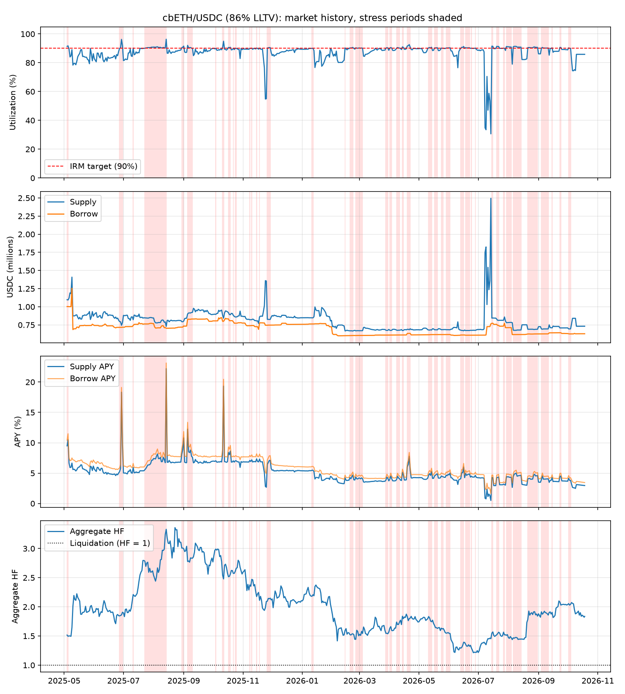

# Morpho Blue market report: cbETH/USDC (86% LLTV)
Market `0xdba352d93a64b17c71104cbddc6aef85cd432322a1446b5b65163cbbc615cd0c` | chain 8453 | data 2025-05-04 to 2026-10-18 (534 days) | generated 2026-10-18

## Summary
| Metric | Value |
|---|---|
| Latest supply / borrow (USDC) | 731,760 / 628,190 |
| Latest utilization | 85.8% |
| Days >= 90% utilization | 161 of 534 (30.1%) |
| Stress episodes / median duration | 43 / 3 d |
| Mean utilization in stress | 90.7% |
| Lowest free liquidity in stress | 26,732 USDC |
| Mean supply APY, stress vs normal | 5.78% vs 4.85% |
| Aggregate HF, min / stress median | 1.21 / 1.84 |
| Implied rate_at_target (stress mean) | 5.12% |

## Stress episodes (utilization >= 90%, amounts in USDC)
| Start | End | Days | Mean util | Max util | Min free liq | Peak supply | Peak borrow | Min agg HF |
|---|---|---|---|---|---|---|---|---|
| 2025-05-04 | 2025-05-05 | 2 | 91.6% | 91.7% | 90,386 | 1,097,273 | 1,002,980 | 1.49 |
| 2025-06-27 | 2025-06-30 | 4 | 92.1% | 96.2% | 28,060 | 795,897 | 717,996 | 1.85 |
| 2025-07-11 | 2025-07-11 | 1 | 90.2% | 90.2% | 80,468 | 821,835 | 741,366 | 2.21 |
| 2025-07-23 | 2025-08-14 | 23 | 90.8% | 96.3% | 26,732 | 852,136 | 771,918 | 2.44 |
| 2025-08-30 | 2025-09-01 | 3 | 90.9% | 91.6% | 67,715 | 803,055 | 735,341 | 3.00 |
| 2025-09-05 | 2025-09-10 | 6 | 90.6% | 92.1% | 71,366 | 922,756 | 831,101 | 2.77 |
| 2025-10-04 | 2025-10-04 | 1 | 90.0% | 90.0% | 89,281 | 894,835 | 805,554 | 2.99 |
| 2025-10-11 | 2025-10-12 | 2 | 92.7% | 95.0% | 42,528 | 883,782 | 800,035 | 2.48 |
| 2025-10-17 | 2025-10-19 | 3 | 90.6% | 90.7% | 82,534 | 919,250 | 833,188 | 2.52 |
| 2025-10-22 | 2025-10-22 | 1 | 90.0% | 90.0% | 87,860 | 881,831 | 793,971 | 2.57 |
| 2025-10-24 | 2025-10-25 | 2 | 90.0% | 90.0% | 85,575 | 859,607 | 773,955 | 2.61 |
| 2025-11-08 | 2025-11-08 | 1 | 90.1% | 90.1% | 81,440 | 820,763 | 739,323 | 2.38 |
| 2025-11-10 | 2025-11-10 | 1 | 90.1% | 90.1% | 81,261 | 822,465 | 741,205 | 2.47 |
| 2025-11-15 | 2025-11-15 | 1 | 90.2% | 90.2% | 78,883 | 804,232 | 725,350 | 2.18 |
| 2025-11-18 | 2025-11-18 | 1 | 90.2% | 90.2% | 84,667 | 860,740 | 776,074 | 2.11 |
| 2025-11-26 | 2025-11-29 | 4 | 90.4% | 90.5% | 78,293 | 826,736 | 747,120 | 2.10 |
| 2026-01-11 | 2026-01-12 | 2 | 90.0% | 90.0% | 84,464 | 847,679 | 763,207 | 2.18 |
| 2026-02-14 | 2026-02-14 | 1 | 90.3% | 90.3% | 64,670 | 666,384 | 601,715 | 1.60 |
| 2026-02-19 | 2026-02-22 | 4 | 90.4% | 90.6% | 62,495 | 669,826 | 603,855 | 1.52 |
| 2026-02-25 | 2026-03-04 | 8 | 90.2% | 90.4% | 64,377 | 670,931 | 604,607 | 1.44 |
| 2026-03-28 | 2026-03-30 | 3 | 90.3% | 90.5% | 64,215 | 676,836 | 609,739 | 1.54 |
| 2026-04-01 | 2026-04-03 | 3 | 90.3% | 90.6% | 63,559 | 676,689 | 610,238 | 1.59 |
| 2026-04-08 | 2026-04-11 | 4 | 90.3% | 90.6% | 63,755 | 678,086 | 611,245 | 1.70 |
| 2026-04-14 | 2026-04-15 | 2 | 90.8% | 91.0% | 60,348 | 674,633 | 611,390 | 1.80 |
| 2026-04-19 | 2026-04-22 | 4 | 91.7% | 92.6% | 50,440 | 696,822 | 633,208 | 1.76 |
| 2026-05-11 | 2026-05-14 | 4 | 90.5% | 90.7% | 62,885 | 682,547 | 616,400 | 1.74 |
| 2026-05-17 | 2026-05-20 | 4 | 90.3% | 90.4% | 65,449 | 683,216 | 616,583 | 1.63 |
| 2026-05-24 | 2026-05-26 | 3 | 90.1% | 90.2% | 67,251 | 684,842 | 616,738 | 1.62 |
| 2026-05-29 | 2026-06-02 | 5 | 90.3% | 90.4% | 65,245 | 684,344 | 617,331 | 1.54 |
| 2026-06-13 | 2026-06-16 | 4 | 90.7% | 91.3% | 58,242 | 678,223 | 610,975 | 1.29 |
| 2026-06-18 | 2026-06-22 | 5 | 90.4% | 90.5% | 63,727 | 673,508 | 608,091 | 1.32 |
| 2026-06-24 | 2026-06-24 | 1 | 90.1% | 90.1% | 66,798 | 674,998 | 608,200 | 1.29 |
| 2026-06-28 | 2026-06-28 | 1 | 90.2% | 90.2% | 66,183 | 674,667 | 608,485 | 1.22 |
| 2026-07-15 | 2026-07-16 | 2 | 91.5% | 91.5% | 71,498 | 845,001 | 772,606 | 1.55 |
| 2026-07-20 | 2026-07-22 | 3 | 91.3% | 91.4% | 70,565 | 829,326 | 757,820 | 1.52 |
| 2026-07-27 | 2026-07-28 | 2 | 90.1% | 90.1% | 80,526 | 859,631 | 773,730 | 1.52 |
| 2026-07-30 | 2026-08-04 | 6 | 91.0% | 91.3% | 67,996 | 784,642 | 712,964 | 1.46 |
| 2026-08-06 | 2026-08-14 | 9 | 91.1% | 91.4% | 58,157 | 679,719 | 617,456 | 1.44 |
| 2026-08-21 | 2026-08-31 | 11 | 90.6% | 91.0% | 62,193 | 690,429 | 625,615 | 1.78 |
| 2026-09-04 | 2026-09-11 | 8 | 90.2% | 90.6% | 64,768 | 694,833 | 626,641 | 1.86 |
| 2026-09-15 | 2026-09-15 | 1 | 90.4% | 90.4% | 68,145 | 708,767 | 640,622 | 1.91 |
| 2026-09-23 | 2026-09-24 | 2 | 90.6% | 90.6% | 66,410 | 708,349 | 641,852 | 2.03 |
| 2026-10-02 | 2026-10-04 | 3 | 90.1% | 90.3% | 67,224 | 694,982 | 627,614 | 2.03 |

## Stress vs normal
| Metric | Normal mean | Normal median | Normal p90 | Stress mean | Stress median | Stress p90 |
|---|---|---|---|---|---|---|
| Utilization | 85.86% | 87.93% | 89.83% | 90.65% | 90.44% | 91.38% |
| Supply APY | 4.85% | 4.85% | 6.83% | 5.78% | 4.70% | 8.12% |
| Borrow APY | 5.63% | 5.84% | 7.72% | 6.38% | 5.23% | 8.98% |
| rate_at_target (APR) | 5.65% | 5.84% | 7.51% | 5.12% | 4.60% | 7.46% |
| Aggregate HF | 2.04 | 1.96 | 2.83 | 1.96 | 1.84 | 2.78 |

## Theoretical supply APY by utilization (AdaptiveCurveIRM shape, fixed rate_at_target)
| rate_at_target | U=90% | U=93% | U=96% | U=100% |
|---|---|---|---|---|
| 2% | 1.8% | 3.5% | 5.4% | 8.0% |
| 4% | 3.6% | 7.1% | 10.8% | 16.0% |
| 8% | 7.2% | 14.1% | 21.5% | 32.0% |

## Expected supply APY on stress days
| rate_at_target | E[supply APY] |
|---|---|
| 2% | 2.17% |
| 4% | 4.34% |
| 8% | 8.69% |
| realized | 5.78% |

## Notes
- Theoretical rows hold rate_at_target fixed; the real curve adapts over time, so use the realized row.
- Aggregate HF = collateral USD x LLTV / borrow USD. It averages across borrowers and hides weak positions.
- Daily samples; intraday spikes in utilization are not captured.
