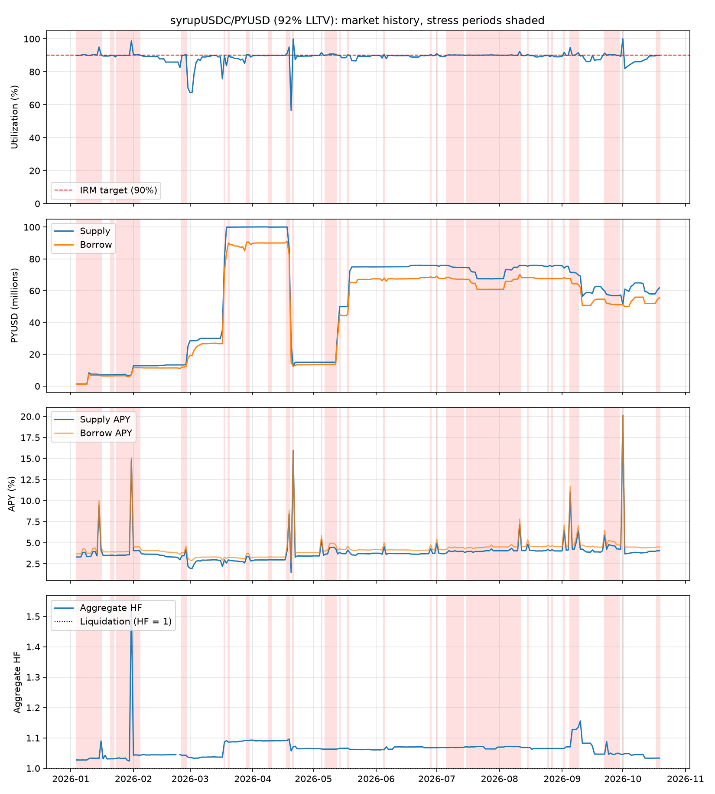

# Morpho Blue market report: syrupUSDC/PYUSD (92% LLTV)
Market `0xc9629945524f3fde56c7e8854a6c3d48e76b9d97236abbe73c750fcc7aeb8501` | chain 1 | data 2026-01-04 to 2026-10-19 (290 days) | generated 2026-10-19

## Summary
| Metric | Value |
|---|---|
| Latest supply / borrow (PYUSD) | 61,775,539 / 55,610,552 |
| Latest utilization | 90.0% |
| Days >= 90% utilization | 108 of 290 (37.2%) |
| Stress episodes / median duration | 27 / 1 d |
| Mean utilization in stress | 90.7% |
| Lowest free liquidity in stress | 0 PYUSD |
| Mean supply APY, stress vs normal | 4.57% vs 3.50% |
| Aggregate HF, min / stress median | 1.02 / 1.07 |
| Implied rate_at_target (stress mean) | 4.07% |

## Stress episodes (utilization >= 90%, amounts in PYUSD)
| Start | End | Days | Mean util | Max util | Min free liq | Peak supply | Peak borrow | Min agg HF |
|---|---|---|---|---|---|---|---|---|
| 2026-01-04 | 2026-01-16 | 13 | 90.6% | 95.0% | 129,568 | 8,364,382 | 7,527,955 | 1.03 |
| 2026-01-21 | 2026-01-22 | 2 | 90.0% | 90.0% | 717,589 | 7,176,668 | 6,459,079 | 1.03 |
| 2026-01-24 | 2026-02-04 | 12 | 90.8% | 98.7% | 92,915 | 12,826,834 | 11,583,677 | 1.02 |
| 2026-02-25 | 2026-02-27 | 3 | 90.2% | 90.6% | 1,281,337 | 13,678,210 | 12,396,872 | 1.04 |
| 2026-03-18 | 2026-03-18 | 1 | 90.0% | 90.0% | 7,984,643 | 79,847,342 | 71,862,699 | 1.09 |
| 2026-03-20 | 2026-03-20 | 1 | 90.0% | 90.0% | 9,992,806 | 100,004,170 | 90,011,364 | 1.09 |
| 2026-03-29 | 2026-03-30 | 2 | 90.5% | 90.5% | 9,491,013 | 100,082,044 | 90,591,031 | 1.09 |
| 2026-04-09 | 2026-04-10 | 2 | 90.0% | 90.0% | 9,990,594 | 100,011,497 | 90,020,303 | 1.09 |
| 2026-04-18 | 2026-04-19 | 2 | 93.1% | 95.0% | 4,337,560 | 100,077,313 | 91,200,031 | 1.09 |
| 2026-04-21 | 2026-04-21 | 1 | 99.9% | 99.9% | 13,001 | 12,465,377 | 12,452,376 | 1.07 |
| 2026-05-05 | 2026-05-05 | 1 | 91.7% | 91.7% | 1,246,614 | 15,013,967 | 13,767,353 | 1.06 |
| 2026-05-07 | 2026-05-12 | 6 | 90.5% | 90.8% | 1,383,643 | 15,025,595 | 13,640,193 | 1.06 |
| 2026-05-14 | 2026-05-14 | 1 | 90.0% | 90.0% | 4,979,324 | 49,993,973 | 45,014,649 | 1.07 |
| 2026-05-18 | 2026-05-18 | 1 | 90.3% | 90.3% | 4,871,331 | 50,014,694 | 45,143,362 | 1.07 |
| 2026-06-05 | 2026-06-05 | 1 | 90.6% | 90.6% | 7,022,369 | 75,023,569 | 68,001,201 | 1.06 |
| 2026-06-28 | 2026-06-28 | 1 | 90.5% | 90.5% | 7,219,715 | 75,961,916 | 68,742,201 | 1.07 |
| 2026-07-01 | 2026-07-01 | 1 | 91.0% | 91.0% | 6,853,848 | 75,994,884 | 69,141,035 | 1.07 |
| 2026-07-06 | 2026-07-14 | 9 | 90.2% | 90.2% | 7,309,700 | 75,964,889 | 68,410,930 | 1.07 |
| 2026-07-16 | 2026-08-11 | 27 | 90.2% | 92.3% | 5,814,889 | 75,997,631 | 70,182,743 | 1.06 |
| 2026-08-15 | 2026-08-15 | 1 | 90.6% | 90.6% | 7,106,557 | 75,363,263 | 68,256,705 | 1.07 |
| 2026-08-25 | 2026-08-25 | 1 | 90.1% | 90.1% | 7,434,898 | 75,137,656 | 67,702,758 | 1.07 |
| 2026-08-27 | 2026-08-27 | 1 | 90.1% | 90.1% | 7,469,149 | 75,109,284 | 67,640,135 | 1.07 |
| 2026-09-02 | 2026-09-02 | 1 | 91.8% | 91.8% | 6,097,075 | 74,239,902 | 68,142,827 | 1.07 |
| 2026-09-05 | 2026-09-09 | 5 | 91.4% | 94.8% | 3,736,947 | 71,538,252 | 67,801,305 | 1.07 |
| 2026-09-22 | 2026-09-29 | 8 | 90.3% | 91.3% | 5,181,810 | 59,902,296 | 54,720,486 | 1.05 |
| 2026-10-01 | 2026-10-01 | 1 | 100.0% | 100.0% | 0 | 51,223,904 | 51,223,904 | 1.05 |
| 2026-10-18 | 2026-10-19 | 3 | 90.0% | 90.0% | 6,008,189 | 61,775,539 | 55,610,552 | 1.03 |

## Stress vs normal
| Metric | Normal mean | Normal median | Normal p90 | Stress mean | Stress median | Stress p90 |
|---|---|---|---|---|---|---|
| Utilization | 88.08% | 89.31% | 89.96% | 90.66% | 90.11% | 91.20% |
| Supply APY | 3.50% | 3.66% | 4.03% | 4.57% | 4.04% | 5.17% |
| Borrow APY | 3.97% | 4.11% | 4.53% | 5.01% | 4.50% | 5.70% |
| rate_at_target (APR) | 3.95% | 4.05% | 4.49% | 4.07% | 4.14% | 4.57% |
| Aggregate HF | 1.06 | 1.06 | 1.09 | 1.07 | 1.07 | 1.09 |

## Theoretical supply APY by utilization (AdaptiveCurveIRM shape, fixed rate_at_target)
| rate_at_target | U=90% | U=93% | U=96% | U=100% |
|---|---|---|---|---|
| 2% | 1.8% | 3.5% | 5.4% | 8.0% |
| 4% | 3.6% | 7.1% | 10.8% | 16.0% |
| 8% | 7.2% | 14.1% | 21.5% | 32.0% |

## Expected supply APY on stress days
| rate_at_target | E[supply APY] |
|---|---|
| 2% | 2.19% |
| 4% | 4.38% |
| 8% | 8.76% |
| realized | 4.57% |

## Notes
- Theoretical rows hold rate_at_target fixed; the real curve adapts over time, so use the realized row.
- Aggregate HF = collateral USD x LLTV / borrow USD. It averages across borrowers and hides weak positions.
- Daily samples; intraday spikes in utilization are not captured.
